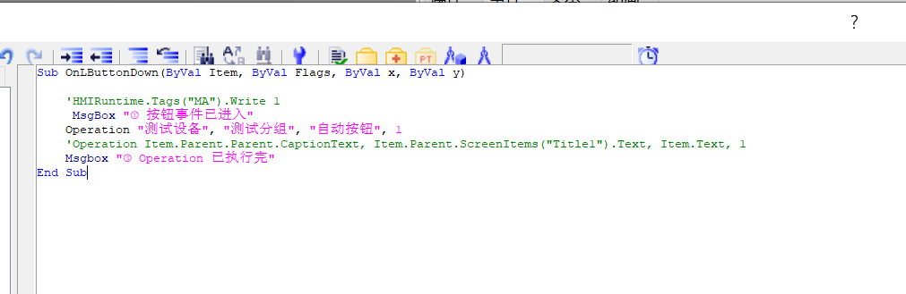
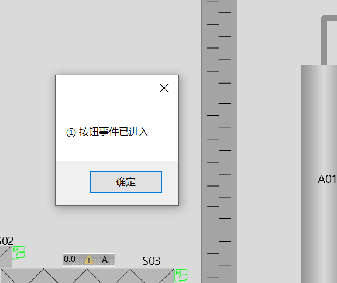
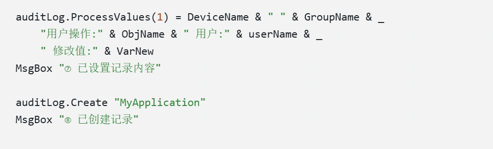

[简体中文](../zh/debug-vbs.md)

## Observed Condition and Diagnostic Method

The expected audit record was absent after a device operation. Numbered `MsgBox` checkpoints were used to distinguish button-event entry, procedure entry and progress through key statements. [S07](sources.md#s07)

The second image establishes only that entry prompt ① appeared in that test. It does not establish later checkpoint execution or successful record creation.

## Fault Localization

| Checkpoint | Recorded observation | Assessment |
| --- | --- | --- |
| Operation entry | Entry confirmed after an internal prompt was added | Continue within the procedure |
| Prompt ⑥ after state assignment | Appeared | Execution reached this point |
| Prompt ⑦ after process-value assignment | Did not appear | Inspect the complete assignment between ⑥ and ⑦ |
| Prompt ⑧ after Create | Did not appear | No evidence that execution reached Create |

Personal confirmation identified a missing character in a device parameter name, inconsistent with the declaration. The screenshot identifies the statement area but does not preserve the complete misspelling; the missing character is not reconstructed.

## Outcome and Record Chronology

- 2026-10-04: the investigation note records checkpoints and the confirmed spelling issue; the complete audit outcome was not separately recorded at that stage.
- 2026-10-12: a subsequent interview records personal confirmation of normal behavior after correction. [S04](sources.md#s04)
- Current preparation: both evidence stages are retained without a new execution. The additional Err template is not presented as a tested solution.

## Technical Findings

Checkpoints localize the investigation to statements between adjacent prompts. Complex expressions can then be separated into string construction, object access and property assignment. Corrective verification must examine the business result rather than prompt completion alone. MsgBox requires confirmation and alters timing; temporary diagnostic prompts should be removed after testing.

Related: [checkpoint localization](concepts/tracing.md) · [WinCC topic](wincc.md) · [evidence E02](evidence.md#e02)
