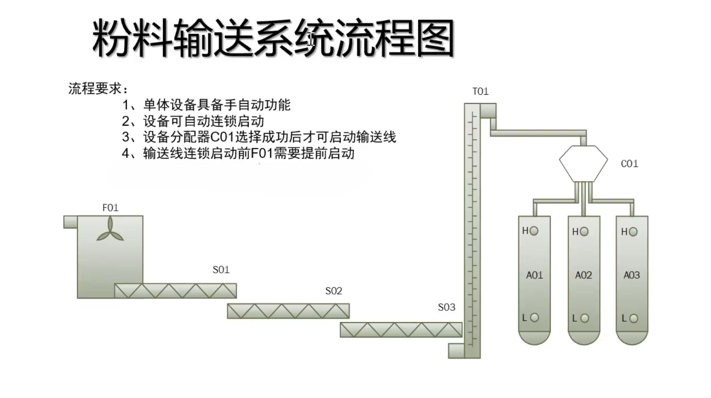

<a href="../index.md">简体中文 ↗</a>

<section class="portfolio-hero" aria-label="Portfolio introduction">

AUTOMATION · PERSONAL ENGINEERING PROJECT

<h2>Powder conveying. Control, built step by step.</h2>

A PLC / WinCC practice project by 无空, developed from blank engineering projects: process analysis, control programming, HMI configuration and iterative debugging.

TIA Portal V16WinCC ClassicSimulation + physical PLC

<a class="portfolio-button" href="powder.md">Explore the project →</a><a class="portfolio-button secondary" href="#program-downloads">Download engineering files ↓</a>

</section>

<h2 id="program-downloads">Engineering downloads</h2><a href="downloads.md">Versions & opening notes ↗</a>

<section class="program-card">01 / SIMULATION<h3>PLC · Simulation</h3>
For simulated signals, control logic and WinCC integration.
ZIP · TIA Portal V16 · 1.1 MB<a class="download-link" href="../downloads/plc-simulation-v1.zip" download data-no-popover>Download project ↓</a></section>
<section class="program-card">02 / PHYSICAL PLC<h3>PLC · Physical</h3>
For physical-PLC connections, variables and output-state checks.
ZIP · TIA Portal V16 · 1.2 MB<a class="download-link" href="../downloads/plc-physical-v1.zip" download data-no-popover>Download project ↓</a></section>
<section class="program-card">03 / HMI ENGINEERING<h3>WinCC · Full project</h3>
Original screens, scripts, configuration and project databases.
RAR · WinCC Classic · 54.8 MB<a class="download-link" href="../downloads/wincc-project-20260918.rar" download data-no-popover>Download project ↓</a></section>

<nav class="supporting-links" aria-label="Supporting documents">Supporting files<a href="../tables/powder-equipment-io.xlsx" download data-no-popover>Equipment & I/O table</a><a href="../downloads/process-understanding.txt" download data-no-popover>Original process note</a><a href="../downloads/powder-process.png" download data-no-popover>Process diagram</a></nav>

<figure class="process-figure"><figcaption>Process reference supplied by the author · Open image for full-size labels.</figcaption></figure>

## Explore the implementation

<a class="topic-card" href="powder.md"><strong>Process & control structure ↗</strong>Equipment coordination, automatic sequencing and the S01 signal path.</a>
<a class="topic-card" href="wincc.md"><strong>HMI configuration & popup reuse ↗</strong>Modular screens, tag prefixes and shared device popups.</a>
<a class="topic-card" href="debug-qv.md"><strong>Variable-display fault analysis ↗</strong>Tracing values, bindings and display formats.</a>
<a class="topic-card" href="debug-vbs.md"><strong>Script-interruption diagnosis ↗</strong>Narrowing failures with checkpoints and error handling.</a>

## Personal responsibilities

<ul class="contribution-list"><li>PLC project creation and programming: reusable control conditions and equipment coordination.</li><li>WinCC screens and scripts: main and system screens and device popups built progressively from blank screens.</li><li>Engineering documentation: equipment, I/O, alarm and archive-configuration tables.</li><li>Debugging and revision: simulation integration and scoped physical-PLC variable, output-LED and HMI checks.</li></ul>

<aside class="scope-note"><strong>Verification scope</strong>
Physical PLC outputs were checked without external loads. Download integrity checks do not establish compilation, commissioning or full-system acceptance for these exact files.
<a href="evidence.md">Evidence & scope →</a> · <a href="sources.md#s15">Construction statement</a></aside>

<a href="knowledge.md">Technical concepts</a> · <a href="tables.md">Workbook previews</a> · <a href="wiring.md">Wiring practice</a> · <a href="learning.md">Learning progress</a> · <a href="sources.md">Sources & attribution</a> Chinese and English pages are linked; sidebar backlinks connect cases, concepts and evidence. · 2026-10-28

