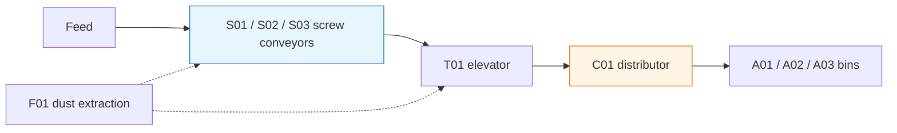

[简体中文](../zh/powder.md)

## Project Overview

This PLC and WinCC learning project covers screw conveyors S01/S02/S03, elevator T01, distributor C01, bins A01/A02/A03 and dust-extraction fan F01. The process objective is to transfer powder from the feed point to a selected bin. The description is derived from personal process notes and existing project material. [S01](sources.md#s01)

The diagram is a redrawn process illustration. Equipment identifiers and planned addresses are available in the [equipment and I/O workbook](table-powder.md).

## Personal Responsibilities

| Area | Contribution | Source |
| --- | --- | --- |
| Overall PLC automatic logic | Development of the overall automatic logic, encapsulation of repeated start conditions in an FB, and organization of device relationships | [S04](sources.md#s04) |
| WinCC screens and scripts | Main, login and system screens, main-screen scripts, and Chinese/English switching | [S04](sources.md#s04) |
| Project construction and configuration | Step-by-step development of PLC programs, WinCC screens and scripts from blank projects, together with equipment, I/O and alarm tables and iterative debugging | [S15](sources.md#s15) |

The author developed the project progressively from blank engineering projects, covering project creation, control programming, screen configuration and supporting documentation, with iterative debugging and refinement. Implementation records, technical learning references and verification results are documented separately. See the [construction statement](sources.md#s15).

## Control Structure and Signal Path

The organization separates individual-device control from automatic coordination. Historical exports show OB1, Main_Call, and system, device and interlock calls. This provides architectural context; block identifiers and calls require confirmation against the intended presentation version. [S03](sources.md#s03)

The S01 path includes device selection, shared-popup loading, mode and start/stop commands, PLC permissive evaluation, control output and state display. `A_OP`, `Q_Run` and `FB_Running` represent a start request, control output and running feedback respectively. Their sources and physical meanings must be identified. See [control signals](concepts/state.md).

## Engineering Variants and Verification Scope

The PLC has [simulation and field variants](versions.md). Recent personal records report Sim operating with WinCC, without a verified association to the current file fingerprints. Recorded field-variant checks cover physical-PLC variables, output LEDs and HMI states. Outputs had no external loads, and inputs were changed or forced through a watch table. [S04](sources.md#s04), [S10](sources.md#s10)

## Related Material

- [WinCC screen and popup reuse](wincc.md)
- [WinCC alarm and archive configuration workbook](table-wincc.md)
- [Value-display investigation](debug-qv.md) and [script-interruption investigation](debug-vbs.md)
- [Evidence index](evidence.md) and [technical concepts](knowledge.md)

This public edition contains technical documentation, workbooks and process screenshots. Complete runnable TIA/WinCC projects are not included.
