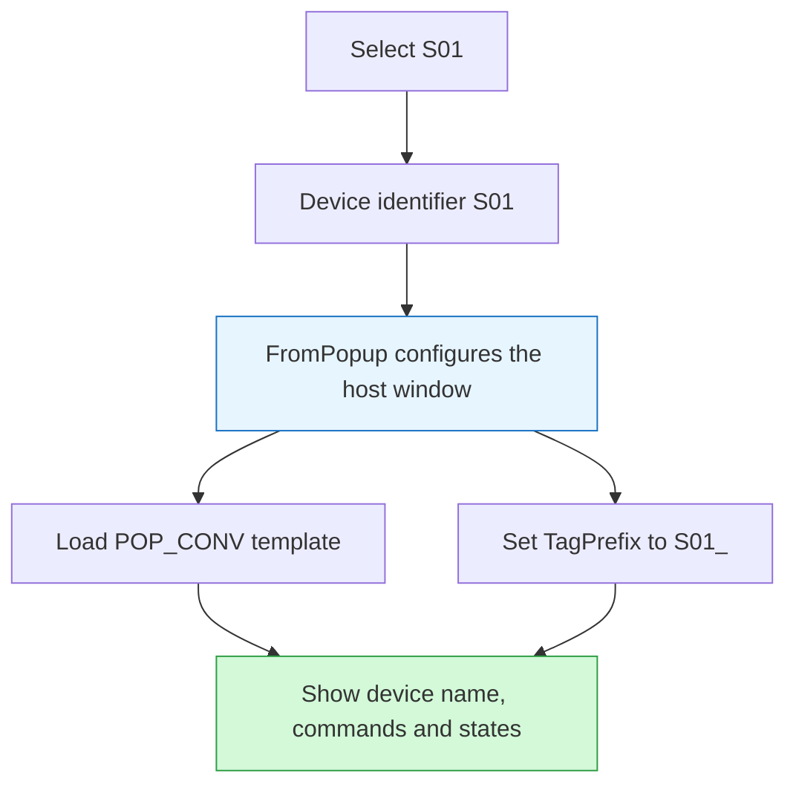

[简体中文](../zh/wincc.md)

This topic forms part of the HMI configuration for the [powder-conveying system](powder.md).

## Design Objective

Reusable screens, device tag prefixes and a shared popup procedure address repeated configuration for similar devices and reduce maintenance of equivalent interface structures. [S04](sources.md#s04), [S05](sources.md#s05)

## Implementation Approach

The existing `FromPopup` note records the host-window sequence: hide the window, assign position, load `PictureName`, assign `TagPrefix` and `CaptionText`, then display the window. Appending an underscore to `S01` produces `S01_`, which works with the template's common member-name convention. [S05](sources.md#s05)

Prefix assignment distinguishes device objects; it does not independently verify PLC connection addresses or communication. See [prefixes and templates](concepts/prefix.md).

## Personal Responsibilities and References

The author built the WinCC configuration progressively from blank screens, including the main, login and system screens, device popups, tag associations, scripts and language switching, with iterative debugging and revision. Technical learning material supported understanding of principles and methods; engineering creation and implementation were performed by the author. [S15](sources.md#s15) Existing screens, procedure code and investigation records provide implementation detail. [S04](sources.md#s04), [S05](sources.md#s05)

## Configuration and Investigation Material

| Subject | Related material |
| --- | --- |
| Alarm, warning, fault and analog-archive configuration | [WinCC workbook and preview](table-wincc.md) |
| Displayed values and control states | [Commands, outputs and feedback](concepts/state.md) |
| Numeric-display issue | [Q_V zero-display investigation](debug-qv.md) |
| Interrupted operation script | [MsgBox checkpoint investigation](debug-vbs.md) |

## Material Scope

This account derives from notes and historical captures. WinCC was not started or functionally retested during preparation. The script collection records project captures, historical versions and note material by source. Its entry count describes the scope of the collection; runtime verification is documented separately in test records. [S03](sources.md#s03), [S13](sources.md#s13)

Related: [powder case](powder.md) · [evidence index](evidence.md)
