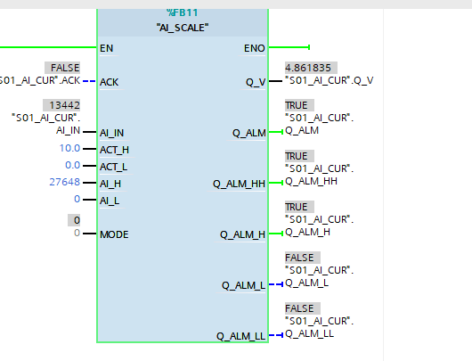
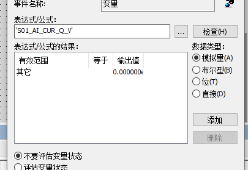
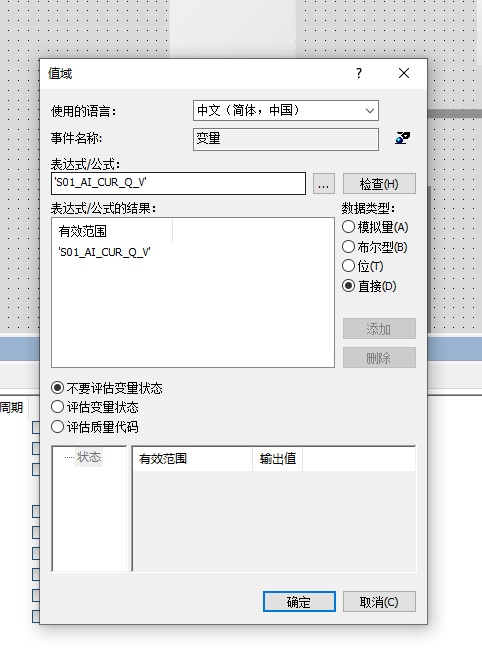

[English](../en/debug-qv.md)

## 异常现象

博途在线监控显示 `AI_SCALE.Q_V = 4.861835`，WinCC 编辑画面显示 `0.000`。动态对话框原配置采用“模拟量”范围映射，其中仅设置“其它 → 0”。[S06](sources.md#s06)

## 排查与处理

| 步骤 | 操作或观察 | 判断 |
| --- | --- | --- |
| 1 | 确认 PLC 端存在计算结果 | 优先检查显示配置及观察环境 |
| 2 | 保留 `S01_AI_CUR_Q_V`，将动态对话框改为“直接” | 取消原“其它 → 0”映射 |
| 3 | 编辑画面仍显示零 | 编辑值不足以判断运行结果 |
| 4 | 保存画面并进入 Runtime | 本人反馈运行画面已出现数值 |

## 排查结论与证据限制

本次记录包含原动态映射及编辑环境观察两个因素。未单独测试“保留原映射、仅启动 Runtime”的组合，因此不对两项操作的影响作完全隔离判断。

原笔记保留了本人运行成功的反馈，未附最终成功画面。`4.862` 为依据先前数值计算的三位小数显示示例，不作为最终运行读数。本次整理未复测。

排查顺序可归纳为：确认观察环境、核对属性动态、检查 Runtime 结果，再对仍存在的问题核对变量连接与地址。

关联：[编辑环境与 Runtime](concepts/runtime.md) · [WinCC 专题](wincc.md) · [证据 E01](evidence.md#e01)
