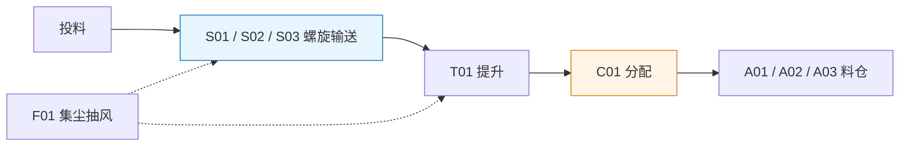

[English](../en/powder.md)

## 项目概述

本项目为 PLC 与 WinCC 综合学习实践，工艺对象包括三台螺旋输送机 S01/S02/S03、提升机 T01、分配器 C01、料仓 A01/A02/A03 及集尘风机 F01。系统目标为将投料端粉料输送至选定料仓。工艺概况依据个人工艺说明及既有项目资料整理。[S01](sources.md#s01)

图示为根据源材料重新编制的工艺关系示意。设备编号及点位资料见[设备清单与 I/O 表](table-powder.md)。

## 个人承担工作

| 工作范围 | 具体内容 | 依据 |
| --- | --- | --- |
| PLC 总体自动逻辑 | 编写总体自动控制逻辑，将重复启动条件封装为 FB，并按设备运行关系组织调用 | [S04](sources.md#s04) |
| WinCC 画面与脚本 | 制作主界面、登录界面、系统界面、主界面脚本及中英文切换 | [S04](sources.md#s04) |
| 工程搭建与组态实现 | 从空白工程逐项创建 PLC 程序、WinCC 画面与脚本，编制设备、点位及报警配置表，并在调试中持续修订 | [S15](sources.md#s15) |

本项目由本人从空白工程起步，按工艺与控制要求逐步完成工程创建、程序编写、画面组态及配套文档编制，并通过调试持续完善。实施过程、技术学习资料与验证结果分别记录，详见[来源说明](sources.md#s15)。

## 控制结构与信号链路

程序组织区分单设备控制与多设备自动协调。历史导出资料显示 OB1、Main_Call 及系统控制、设备调用、联锁调用的层次关系。该结构用于说明设计思路，具体块号与调用关系仍需按拟展示工程核对。[S03](sources.md#s03)

以 S01 为例，控制链路包括：设备选择与通用弹窗加载、模式及启停命令、PLC 允许条件判断、控制输出与状态显示。`A_OP`、`Q_Run` 与 `FB_Running` 分别对应启动请求、控制输出及运行反馈，应明确其数据来源及物理含义。详见[控制信号说明](concepts/state.md)。

## 工程版本与验证范围

PLC 工程分为[模拟仿真版与现场版](versions.md)。近期个人记录支持 Sim 与 WinCC 联调运行的反馈，但未与本次工程文件指纹建立对应关系。现场版的已记录验证范围包括实体 PLC 变量交互、输出指示灯与 WinCC 状态变化，输出未接外设负载，输入通过监控表修改或强制。[S04](sources.md#s04)、[S10](sources.md#s10)

## 关联资料

- [WinCC 画面与弹窗复用](wincc.md)
- [WinCC 报警与归档配置表](table-wincc.md)
- [变量显示异常排查](debug-qv.md)与[脚本执行中断排查](debug-vbs.md)
- [验证证据索引](evidence.md)与[技术概念索引](knowledge.md)

本公开版本包含技术说明、表格及过程截图，未附可直接运行的完整 TIA／WinCC 工程。
