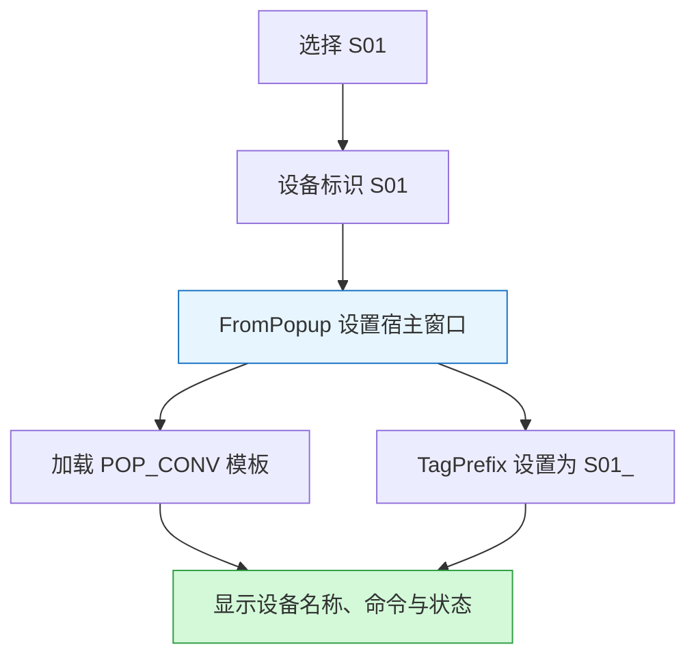

[English](../en/wincc.md)

本专题属于[粉料输送系统](powder.md)的上位机组态内容。

## 设计目标

针对同类设备操作界面重复配置的问题，采用通用画面、设备变量前缀及公共弹窗过程组织设备操作界面，减少相同结构的重复维护。[S04](sources.md#s04)、[S05](sources.md#s05)

## 实现思路

既有 `FromPopup` 笔记记录了宿主窗口的处理顺序：隐藏窗口、设置位置、加载 `PictureName`、赋予 `TagPrefix` 与 `CaptionText`，最后显示窗口。设备编号 `S01` 追加下划线后形成 `S01_`，与模板使用的变量成员约定配合。[S05](sources.md#s05)

变量前缀用于区分设备对象，其设置本身不构成 PLC 连接地址及通信正确性的证明。相关说明见[变量前缀与模板](concepts/prefix.md)。

## 个人承担内容与参考来源

WinCC 工程由本人从空白画面逐项搭建，包含主界面、登录界面、系统界面、设备弹窗、变量关联、脚本编写及中英文切换，并通过调试持续修订。学习笔记中的技术资料用于理解原理与实现方法，工程创建和具体实现由本人完成。[S15](sources.md#s15) 既有画面、过程代码与调试记录用于展开说明。[S04](sources.md#s04)、[S05](sources.md#s05)

## 配套配置与排查记录

| 内容 | 关联资料 |
| --- | --- |
| 报警、警告、故障及模拟量归档配置 | [WinCC 配置工作簿及预览](table-wincc.md) |
| 显示值与控制状态的解释 | [命令、输出及反馈](concepts/state.md) |
| 数值显示异常 | [Q_V 显示为零的排查记录](debug-qv.md) |
| 操作脚本执行中断 | [MsgBox 分段定位记录](debug-vbs.md) |

## 资料范围

本文依据原笔记与历史工程采集说明结构，未在本次整理中启动 WinCC 或复测功能。脚本汇编按工程采集、历史版本及笔记内容记录来源，其条目数量用于说明整理范围，运行验证情况另按测试记录说明。[S03](sources.md#s03)、[S13](sources.md#s13)

关联：[粉料主案例](powder.md) · [证据索引](evidence.md)
